# PixelZen Worlds (Linux GNOME & Windows)

Motor modular de fondos pixel art animados en **640×400** que siguen el ciclo solar y lunar (en tiempo real o en un ciclo completo de **24 horas en 90 minutos**), con soporte para **Linux (GNOME Shell 46–50+)**, **Windows (Lively Wallpaper y app standalone Python)** y **demo interactiva web** en [`docs/`](docs/).

> **Basado en [mosqui1988/pixelzen](https://github.com/mosqui1988/pixelzen)** (port GNOME Shell / KDE Plasma de **PixelZen** bajo licencia `GPL-3.0-or-later`). Este repositorio amplía la base original con un motor procedural en Python puro (`src/`), 5 mundos completos, soporte para Windows/Lively y visor web.

## Mundos incluidos

| Tema (`id`) | Descripción | Día | Atardecer | Noche |
|---|---|---|---|---|
| **Región de Fittoa** (`fittoa`) | Mansión Greyrat, torre de mago, cascada lejana, embarcadero, arco rúnico con cristal de maná y Gran Roble. | 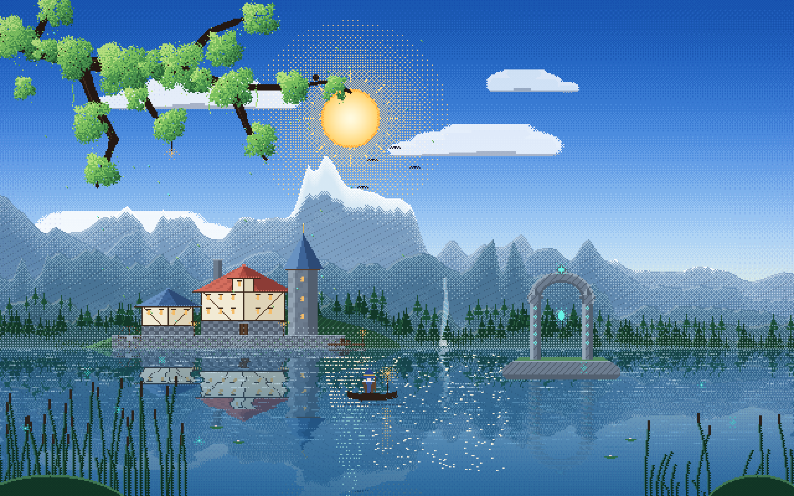 | 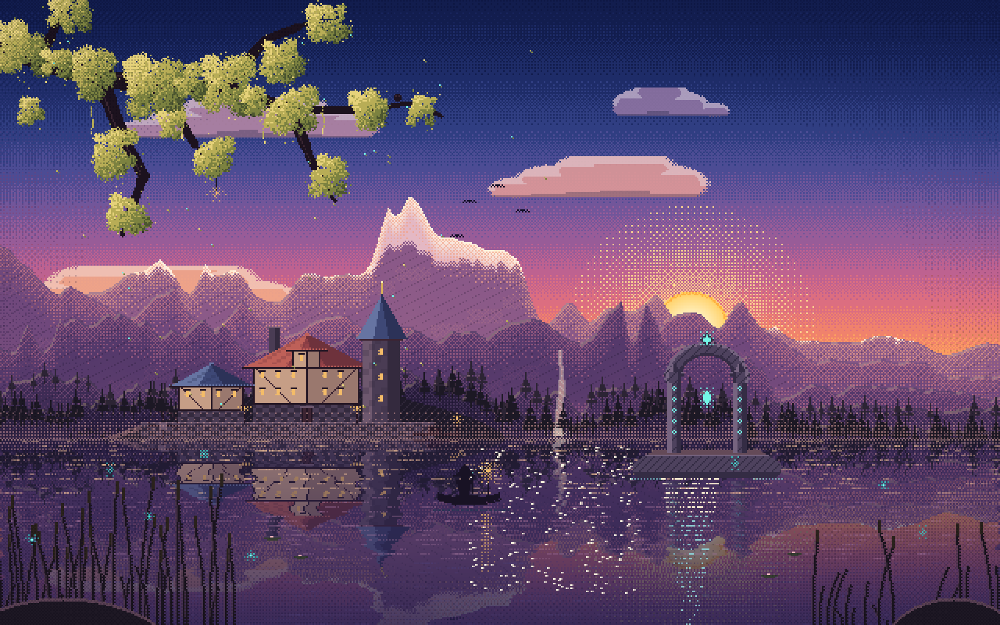 | 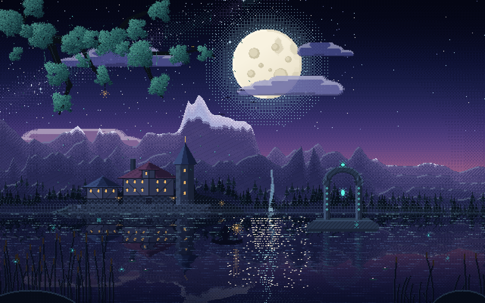 |
| **Continente Demoníaco** (`continente-demoniaco`) | Ciudadela de Rikarisu, acantilado de basalto, racimos de cristales de maná, portal fracturado, río de obsidiana y hongos bioluminiscentes. | 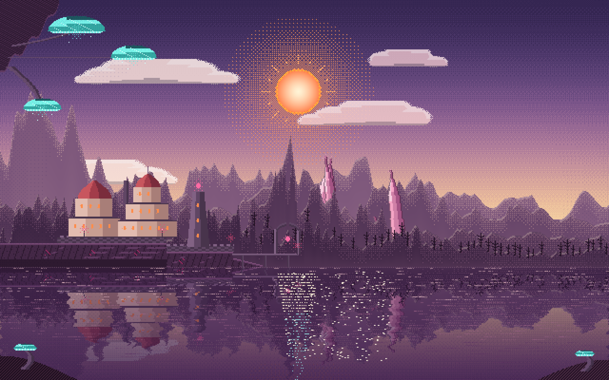 |  | 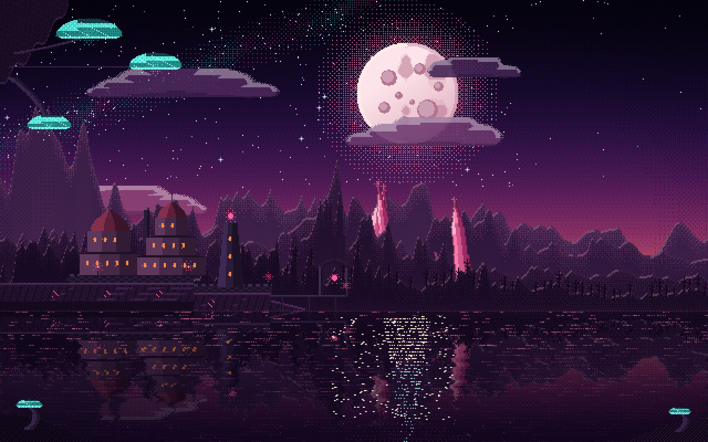 |
| **Isla Ballena · Árbol del Mundo** (`hunter-x-hunter`) | Casa de Mito-san, muelle de Gon, Árbol del Mundo sobre el horizonte, dirigible del Examen de Cazador y silueta costera. | 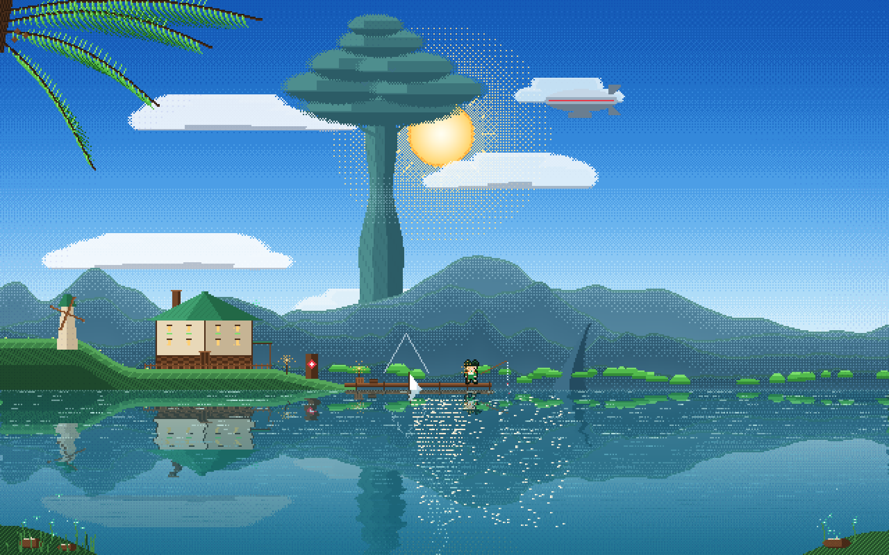 |  | 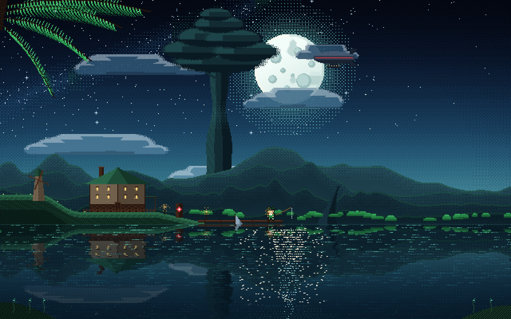 |
| **Reino de Clover · Hage** (`black-clover`) | Cráneo del Demonio gigante con la estatua del Rey Mago, iglesia de Hage, Castillo Clover al fondo y espada de cinco hojas. | 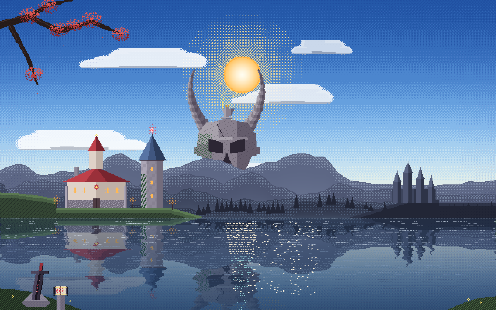 |  | 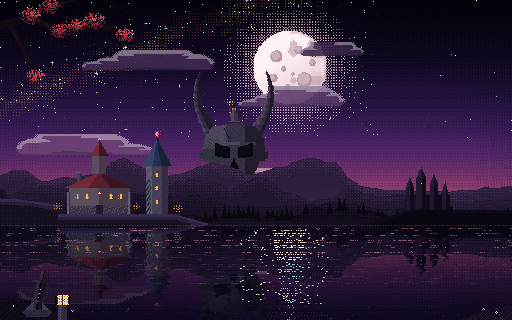 |
| **Nueva York · Miles Morales** (`spiderman-miles-morales`) | Skyline de Manhattan, Puente de Brooklyn anclado, Estatua de la Libertad iluminada, ferry de Staten Island y Miles balanceándose en el cielo. | 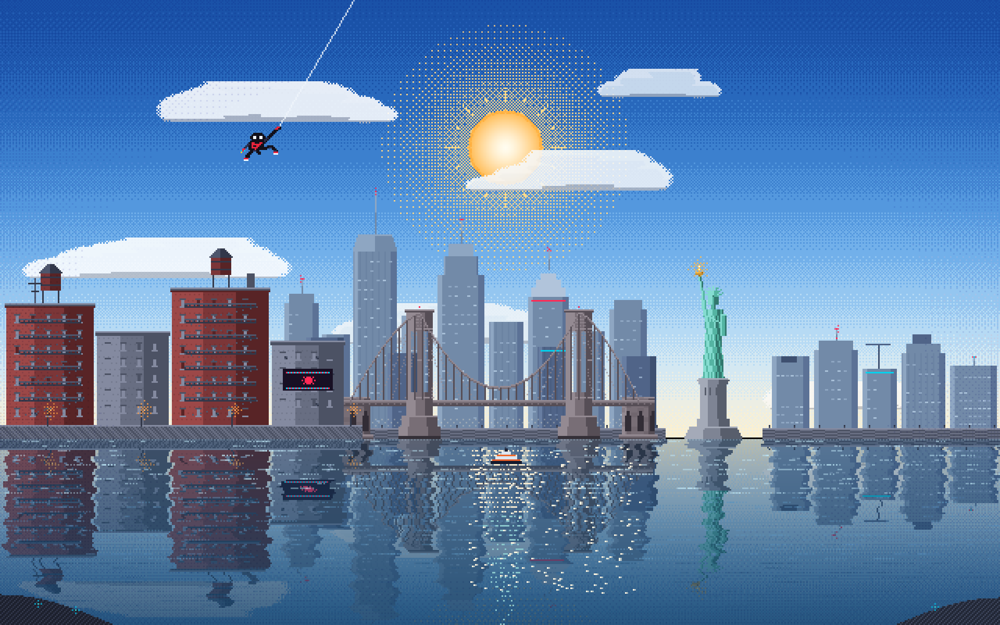 | 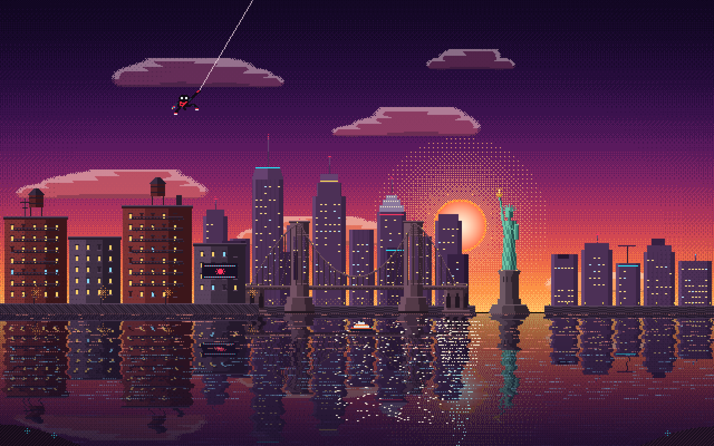 | 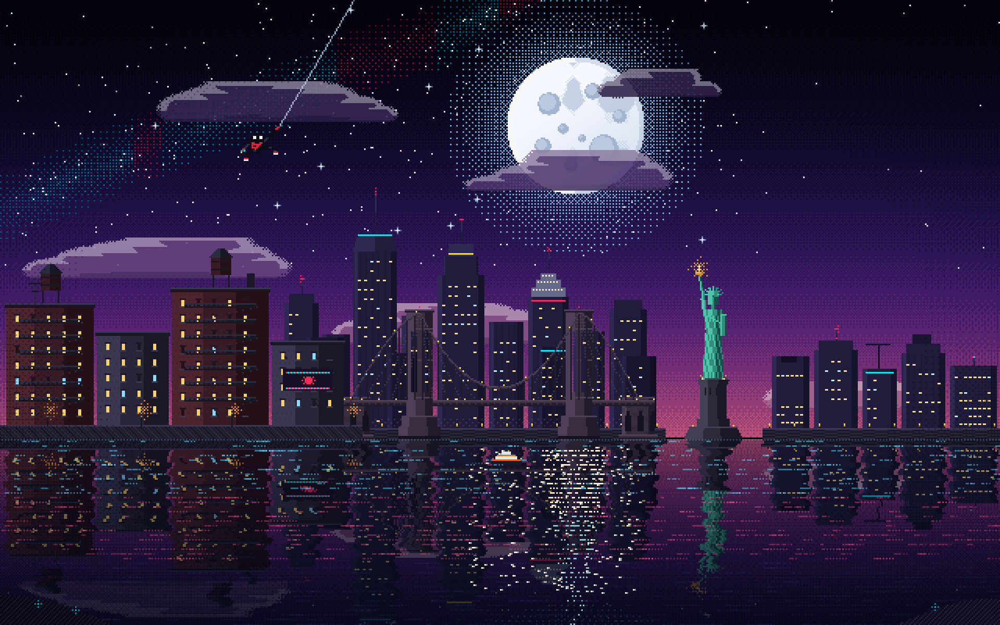 |

## Estructura del repositorio

```text
pixelzen-worlds/
├── escenas/                    # Temas modulares (añadir un fondo = nueva carpeta aquí)
│   ├── _plantilla/             # Plantilla lista para copiar
│   ├── fittoa/                 # Mushoku Tensei - Región de Fittoa
│   ├── continente-demoniaco/   # Mushoku Tensei - Continente Demoníaco
│   ├── hunter-x-hunter/        # Hunter × Hunter - Isla Ballena y Árbol del Mundo
│   ├── black-clover/           # Black Clover - Cráneo del Demonio e Iglesia de Hage
│   └── spiderman-miles-morales/# Spider-Man: Miles Morales - NYC & Puente de Brooklyn
├── src/                        # Motor común en Python puro (pz_lib.py, capas.py, construir.py)
├── linux/                      # Extensión GNOME Shell 46-50+ y scripts (tema.sh, hora.sh, ciclo90.py)
├── windows/                    # Paquete Lively Wallpaper (HTML5 Canvas) + app standalone Python
├── docs/                       # Demo interactiva web (GitHub Pages) sincronizada al compilar
├── fuentes/                    # Fuentes pixel (Departure Mono, PixelifySans, DotGothic16, VT323)
└── licencias/                  # Licencias GPL-3.0, MIT y OFL
```

## Descarga e instalación automática

Los instaladores viven en [`scripts/instalar.sh`](scripts/instalar.sh) (Linux) y [`scripts/instalar.ps1`](scripts/instalar.ps1) (Windows).

### Linux (GNOME Shell 46–50+)

```bash
bash -c "$(curl -fsSL https://raw.githubusercontent.com/davidlpizano/pixelzen-worlds/main/scripts/instalar.sh)"
```

Si el repositorio está en **privado**, ejecuta el mismo script autenticándote con `gh`:

```bash
bash -c "$(gh api repos/davidlpizano/pixelzen-worlds/contents/scripts/instalar.sh -H 'Accept: application/vnd.github.raw')"
```

*(Puedes elegir el tema inicial con `PIXELZEN_TEMA=fittoa` — u otro de los 5 temas — antes de ejecutar el comando).*

### Windows (PowerShell + Lively Wallpaper o Python)

```powershell
irm https://raw.githubusercontent.com/davidlpizano/pixelzen-worlds/main/scripts/instalar.ps1 | iex
```

Si el repositorio está en **privado**, usando `gh`:

```powershell
gh api repos/davidlpizano/pixelzen-worlds/contents/scripts/instalar.ps1 -H "Accept: application/vnd.github.raw" | Out-String | iex
```

## Uso en Linux (GNOME Shell)

- **Desde interfaz gráfica**: abre la app **Extensiones** (o `gnome-extensions prefs pixelzen@mosqui1988.github.io`) para elegir el paisaje, modo horario (`Real`, `90m`, `Demo 90s`, `Hora fija`), FPS y HUD.
- **Desde terminal**:

```bash
cd linux
./instalar.sh --90m                         # Instala con Fittoa y ciclo de 24h en 90 min
./tema.sh --listar                          # Lista todos los mundos disponibles
./tema.sh spiderman-miles-morales           # Cambia al mundo deseado
./tema.sh fittoa                            # Vuelve a Fittoa
./hora.sh 90m                               # Ciclo completo de 24h en 90 minutos
./hora.sh real                              # Hora real del reloj
./hora.sh demo                              # Demo rápida (24h en 90 segundos)
./hora.sh 21:30                             # Congela una hora concreta
```

Consulta [linux/LEEME.md](linux/LEEME.md) para más detalles.

## Uso en Windows

- **Opción 1 (Lively Wallpaper, animado completo + HUD)**: abre `windows/lively/index.html` en [Lively Wallpaper](https://www.rocksdanister.com/lively/) y elige tema y modo (`Hora real` o `Ciclo 24h en 90 minutos`) desde *Personalizar*.
- **Opción 2 (Python standalone)**: ejecuta `windows/ejecutar.bat` o `python windows/pixelzen_win.py --tema spiderman-miles-morales --90m`.

Consulta [windows/LEEME.md](windows/LEEME.md) para más detalles.

## Añadir o recompilar fondos

1. Copia la plantilla: `cp -r escenas/_plantilla escenas/mi-paisaje`
2. Edita `tema.json` y `generar.py` usando las utilidades de `src/pz_lib.py`.
3. Compila para Linux, Windows (`windows/lively/temas/`) y la demo web (`docs/temas/` y `docs/previews/`) con:
   ```bash
   python3 src/construir.py              # Compila todos los temas
   python3 src/construir.py mi-paisaje   # Compila solo un tema concreto
   ```

Consulta [escenas/README.md](escenas/README.md).

## Verificación automática

```bash
python3 tests/verificar.py
```

Comprueba compilación Python (`py_compile`), sintaxis shell (`bash -n`), sincronización del motor JS (`src/pixelzen-canvas.js`), esquema y paridad de los 5 temas y renderizado en `windows/pixelzen_win.py`.

## Créditos y atribución

- **Proyecto original — PixelZen**: creado por **[mosqui1988](https://github.com/mosqui1988)** en **[mosqui1988/pixelzen](https://github.com/mosqui1988/pixelzen)** (extensión original para GNOME Shell / KDE Plasma y sistema base de ciclo solar, HUD y capas).
- **Ampliación y mundos adicionales (`pixelzen-worlds`)**: motor unificado de renderizado pixel art en Python puro (`src/pz_lib.py`), sincronización multi-tema (`src/construir.py`), escenas nuevas y mejoradas (`fittoa`, `continente-demoniaco`, `hunter-x-hunter`, `black-clover`, `spiderman-miles-morales`), adaptación para Windows/Lively y demo interactiva en `docs/`.
- **Tipografías e iconos**: fuentes pixel bajo licencia SIL Open Font License (`OFL`) e iconos bajo `MIT`, detallados en [`licencias/`](licencias/).

## Licencia

Distribuido bajo **GPL-3.0-or-later** en continuidad con el proyecto original (ver [LICENSE](LICENSE) y [licencias/](licencias/)).
