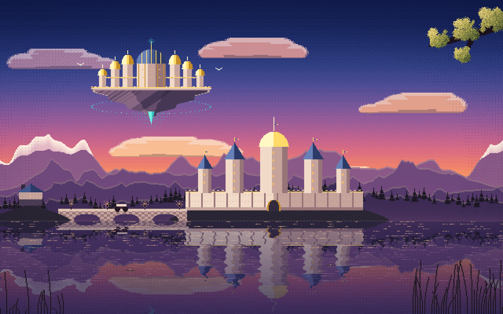
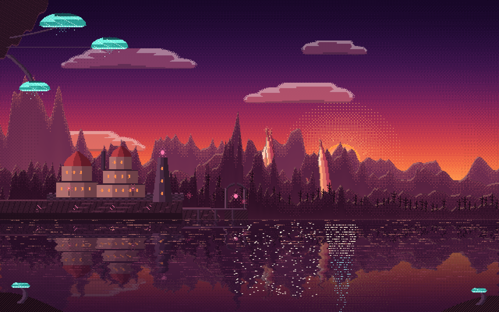
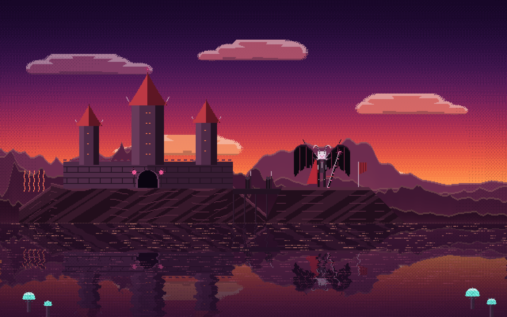
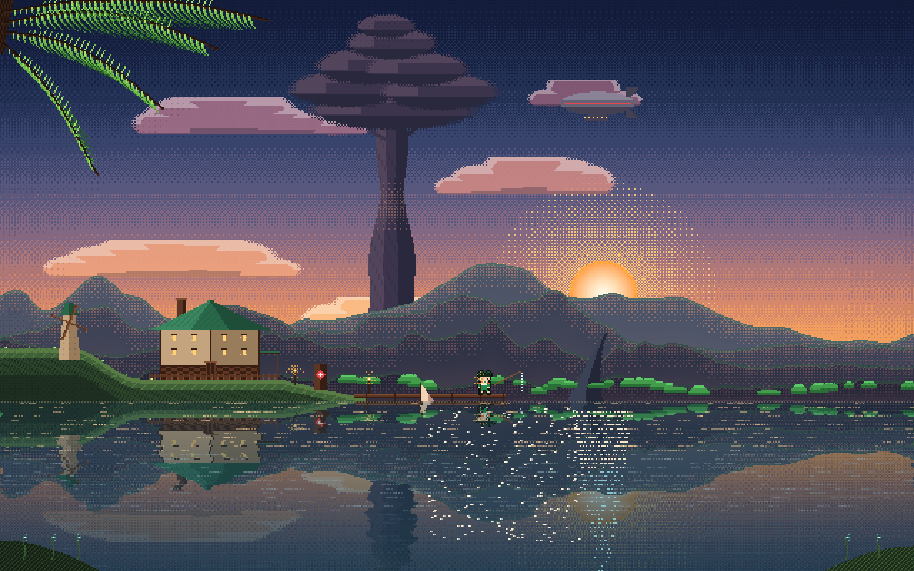
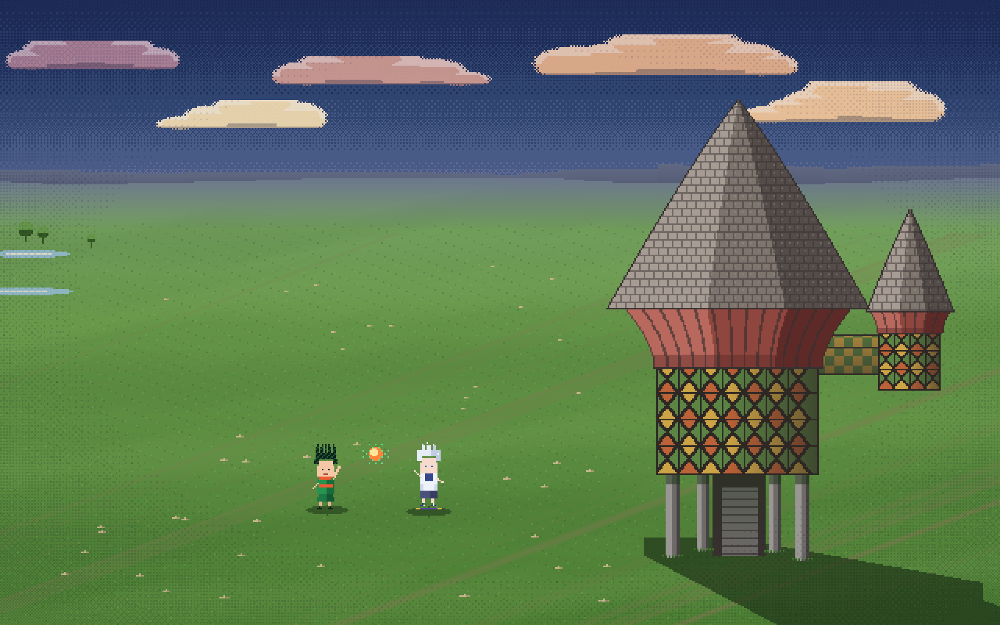
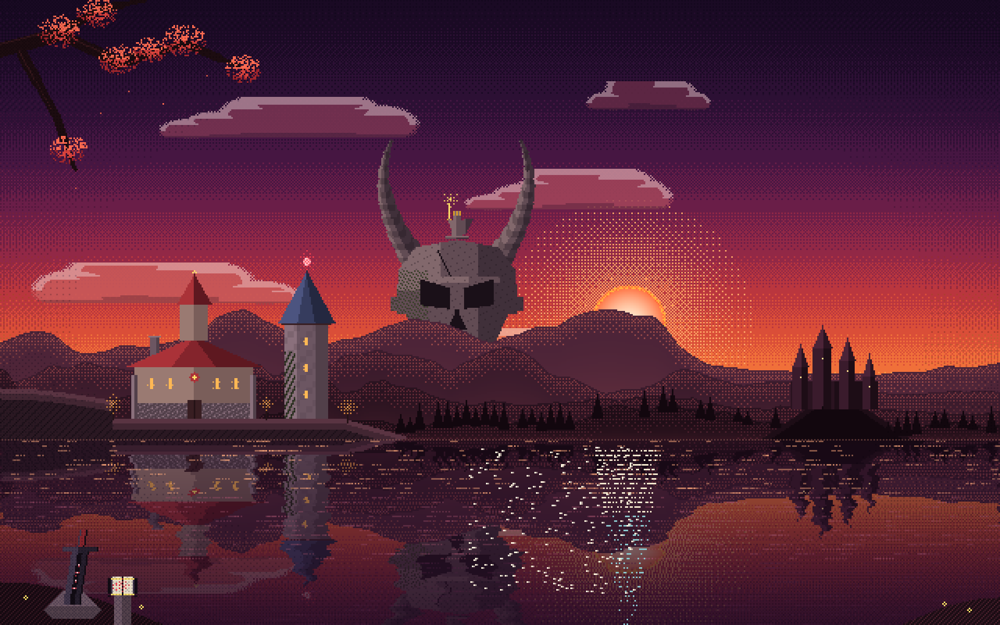
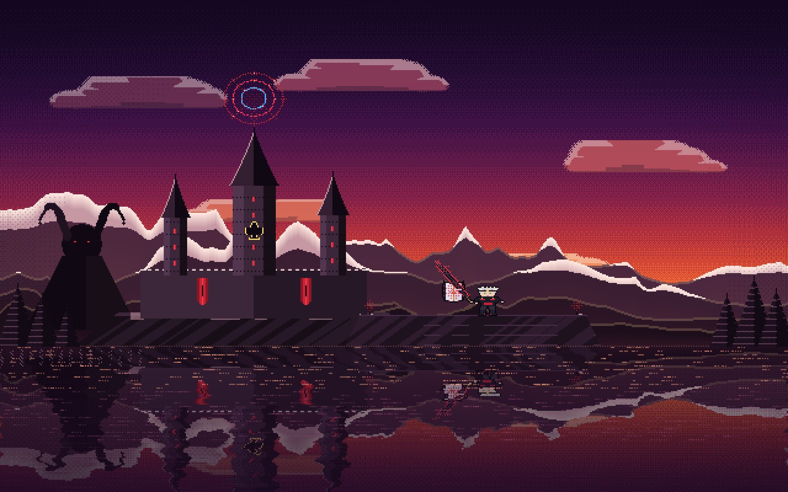
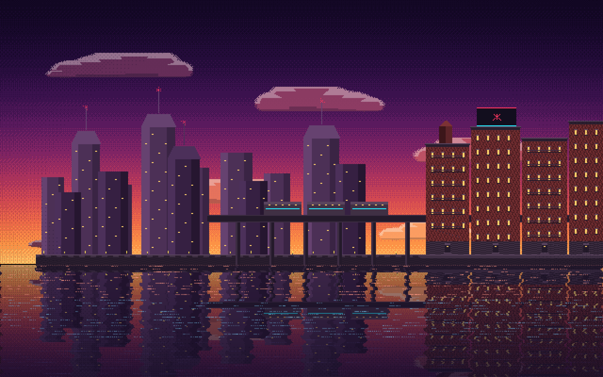

# PixelZen Worlds

[](https://github.com/davidlpizano/pixelzen-worlds/releases/latest)
[](https://github.com/davidlpizano/pixelzen-worlds/releases/latest)
[](LICENSE)

Aplicación de escritorio y motor modular de fondos pixel art animados en **640×400** (escalado nítido **Nearest-Neighbor**) que cambian con la luz del día (**tiempo real**, **ciclo completo de 24 h en 90 minutos**, **demo 90 s** o **hora fija**), con soporte real de **1 o 2 monitores con continuación de historia** y **panel HUD personalizable** para **Windows 10/11**, **Linux (GNOME Shell 46–50+)** y **visor web** en [`docs/`](docs/).

> **Basado en [mosqui1988/pixelzen](https://github.com/mosqui1988/pixelzen)** (port GNOME Shell / KDE Plasma bajo licencia `GPL-3.0-or-later`).

---

## Descarga e instalación (para usuarios · 1 solo archivo)

No necesitas clonar el repositorio, ver carpetas técnicas ni instalar Python. Descarga el instalador de tu sistema desde **[GitHub Releases](https://github.com/davidlpizano/pixelzen-worlds/releases/latest)**:

### Windows 10 / 11
- **Recomendado en Windows 11 (compatible con *Control inteligente de aplicaciones*, sin `.exe`)**: abre **PowerShell** y ejecuta un único comando (no requiere Git ni Python):
  ```powershell
  irm https://raw.githubusercontent.com/davidlpizano/pixelzen-worlds/main/scripts/instalar.ps1 | iex
  ```
  También puedes descargar **`PixelZenWorlds-Windows.zip`** desde Releases, descomprimirlo y ejecutar `Instalar.bat`.
- **Alternativa clásica (`.exe` sin firma comercial)**: descarga **`PixelZenWorlds-Setup.exe`** *(si Windows 11 tiene activado el Control inteligente de aplicaciones lo bloqueará al no tener firma digital de pago; usa el método de PowerShell de arriba)*.

En ambos casos instala la aplicación limpia en `%LOCALAPPDATA%\PixelZenWorlds\app`, crea el acceso directo **PixelZen Worlds** en el Escritorio y Menú Inicio, y se desinstala desde *Configuración → Aplicaciones*.

### Linux (Ubuntu 24.04+ / GNOME Shell 46+)
1. Descarga **`PixelZenWorlds-Linux-Setup.run`**.
2. Ejecútalo desde la terminal (o dale permisos de ejecución y ábrelo):
   ```bash
   chmod +x PixelZenWorlds-Linux-Setup.run
   ./PixelZenWorlds-Linux-Setup.run
   ```
3. Instala la extensión de GNOME, la tipografía *Departure Mono* y añade la app visual **PixelZen Worlds** directamente a tu menú de aplicaciones.

> **Actualizar la app:** tanto en Windows como en Linux, pulsa **`Buscar actualización`** dentro de la propia aplicación (o ejecuta el nuevo instalador encima); tus ajustes, mundo y tarjetas HUD se conservan automáticamente.

---

## Qué incluye la aplicación

* **Galería visual de mundos**: elige fondo viendo su miniatura, título y escenas de Monitor 1 y Monitor 2.
* **Soporte multimonitor con historia continua**:
  * **1 monitor**: muestra la escena principal en el monitor principal del sistema.
  * **2 monitores**: muestra la escena principal en tu **monitor principal** y la **continuación de la historia** en el **2.º monitor** (sin duplicar el sol/luna ni su reflejo entre pantallas).
* **Ciclo solar automático sin dependencias**:
  * **Hora real del sistema** (calculada astronómicamente), **Ciclo suave 24 h en 90 min**, **Demo rápida 90 s** u **Hora fija**.
  * En Windows funciona de forma nativa sin requerir Python; en Linux usa la extensión nativa de GNOME Shell.
* **Panel HUD configurable**: activa o apaga de forma global o por bloques **Reloj y fase lunar**, **Sistema (CPU/RAM/Disco/Batería)**, **Red y tráfico**, **Info Dev** y **Citas del Grimorio**.
* **Bandeja del sistema e inicio automático** (Windows) / **Preferencias GNOME y app GTK4** (Linux).

---

## Mundos incluidos (Monitor 1 + Monitor 2)

| Mundo (`id`) | Monitor 1 (Principal) | Monitor 2 (Continuación) |
|---|---|---|
| **Región de Fittoa** (`fittoa`) · *Mushoku Tensei* |  <br/> Aldea de Buena, Mansión Greyrat, lago, arco rúnico y Gran Roble. |  <br/> Llanuras del Reino de Asura, Capital de Ars y **Base flotante de Perugius (Chaos Breaker)**. |
| **Continente Demoníaco** (`continente-demoniaco`) · *Mushoku Tensei* |  <br/> Ciudadela de Rikarisu, cristales carmesí y portal fracturado. |  <br/> **Castillo de Atofe** en las tierras demoníacas con **Atoferatofe Raibaku**. |
| **Isla Ballena** (`hunter-x-hunter`) · *Hunter × Hunter* |  <br/> Cabaña de Mito-san, muelle de Gon, Árbol del Mundo y dirigible. |  <br/> **Greed Island**: torre/anillo G.I., libro *Book!* y cartas mágicas en el cielo. |
| **Aldea de Hage** (`black-clover`) · *Black Clover* |  <br/> Cráneo del Demonio gigante, iglesia de Hage y espada de cinco hojas. |  <br/> **Reino de Picas** nevado con el castillo helado y la **Tríada Oscura**. |
| **Nueva York · Miles Morales** (`spiderman-miles-morales`) · *Marvel* |  <br/> Puente de Brooklyn, Estatua de la Libertad y Miles balanceándose. |  <br/> Midtown Manhattan, Empire State, metro elevado y Harlem. |

---

## Para desarrolladores (estructura, compilación y empaquetado)

```text
pixelzen-worlds/
├── VERSION                     # Versión única usada por apps, instaladores y Releases
├── escenas/                    # Temas modulares (generar.py + tema.json + secundario/)
│   ├── _plantilla/             # Plantilla lista para crear nuevos mundos
│   └── <tema>/                 # 5 mundos completos + previews (dia/dorado/noche)
├── src/                        # Motor procedural en Python (pz_lib.py, capas.py, construir.py)
├── windows/                    # App visual WPF, motor nativo .NET, HUD e instalador WinForms
├── linux/                      # App visual GTK4 (pixelzen_app.py), extensión GNOME e instalar.sh
├── docs/                       # Visor web interactivo sincronizado al compilar
├── scripts/                    # Empaquetadores (.exe / .run) e instaladores por consola
├── tests/                      # Suite de verificación automática (verificar.py)
├── fuentes/                    # Tipografías pixel (OFL)
└── licencias/                  # Textos de licencias GPL-3.0, MIT y OFL
```

### Añadir o editar un fondo

1. Copia la plantilla `escenas/_plantilla` a `escenas/mi-mundo` (y opcionalmente `escenas/mi-mundo/secundario` para el 2.º monitor).
2. Edita `tema.json` y `generar.py` usando [`src/pz_lib.py`](src/pz_lib.py). Consulta [`escenas/README.md`](escenas/README.md).
3. Compila todos los destinos (`pack/`, `windows/lively/temas/`, `docs/temas/` y `docs/previews/`):
   ```bash
   python3 src/construir.py
   ```
   Tanto la app de Windows como las de Linux descubren los nuevos mundos automáticamente desde `tema.json`.

### Ejecutar pruebas y compilar instaladores localmente

```bash
python3 tests/verificar.py
```

* **Generar instalador Windows** (`dist/PixelZenWorlds-Setup.exe`):
  ```powershell
  powershell -ExecutionPolicy Bypass -File scripts\empaquetar_windows.ps1
  ```
* **Generar instalador Linux** (`dist/PixelZenWorlds-Linux-Setup.run`):
  ```bash
  ./scripts/empaquetar_linux.sh
  ```
* **Publicar nueva Release en GitHub**: actualiza [`VERSION`](VERSION), haz commit y sube una etiqueta `vX.Y.Z`:
  ```bash
  git tag -a vX.Y.Z -m "PixelZen Worlds vX.Y.Z"
  git push origin main --follow-tags
  ```

Más detalles de cada plataforma en [`windows/LEEME.md`](windows/LEEME.md) y [`linux/LEEME.md`](linux/LEEME.md).

---

## Créditos y licencia

* **Proyecto base**: [mosqui1988/pixelzen](https://github.com/mosqui1988/pixelzen) (extensión original para GNOME Shell / KDE Plasma).
* **Fuentes e iconos**: tipografías bajo licencia SIL Open Font License (`OFL`) detalladas en [`licencias/`](licencias/).
* **Licencia**: distribuido bajo **GPL-3.0-or-later** (ver [LICENSE](LICENSE)).
